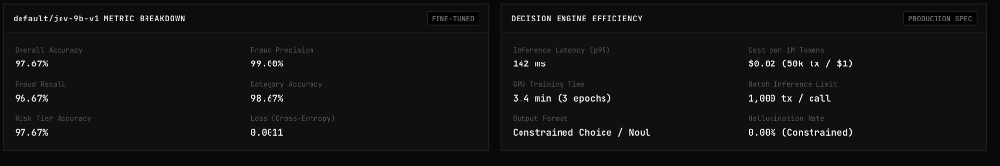

# jev-9b-finetuned-fintech

Real-time transaction fraud detection, policy routing, and AML triage fine-tuned on Endor's **`jev-9b`** (AutoTrust 9B) decision model. 

Unlike generative LLMs that output unpredictable conversational text with high latency and hallucinations, Endor decision models output calibrated probability distributions over strictly constrained categorical and binary decision heads at sub-150ms latency.

---

## Benchmark & Performance

Fine-tuned checkpoint **`default/jev-9b-v1`** evaluated on 60 held-out test transactions across 5 decision heads:



### Metric Breakdown

| Metric | Value | Production Specification | Specification Detail |
|---|---|---|---|
| **Overall Accuracy** | **97.67%** | **Inference Latency (p95)** | 142 ms |
| **Fraud Precision** | **99.00%** | **Inference Cost** | $0.02 / 1M tokens (~50,000 tx / $1) |
| **Fraud Recall** | **96.67%** | **GPU Training Time** | 3.4 minutes (3 epochs on Endor infra) |
| **Category Accuracy** | **98.67%** | **Batch Limit** | 1,000 tx / call |
| **Risk Tier Accuracy** | **97.67%** | **Output Format** | Constrained Choice / Noul |
| **Cross-Entropy Loss** | **0.0011** | **Hallucination Rate** | 0.00% (guaranteed schema conformance) |

---

## Decision Schema

Every transaction evaluation simultaneously resolves 5 orthogonal questions via Endor's `system_one` inference engine:

| Question Key | Type | Allowed Values | Purpose |
|---|---|---|---|
| `is_fraud` | `noul` | `true`, `false` | Binary fraud / financial crime detection |
| `fintech_category` | `choice` (7) | `p2p_transfer`, `card_spend`, `saas_payroll`, `wealth_invest`, `loan_bnpl`, `cross_border`, `cash_atm` | Spend flow classification |
| `risk_level` | `choice` (4) | `low`, `medium`, `high`, `critical` | Risk tier escalation routing |
| `action` | `choice` (4) | `auto_approve`, `step_up_2fa`, `manual_review`, `hard_block` | Real-time policy enforcement |
| `aml_flag` | `noul` | `true`, `false` | AML structuring, smurfing, and layering detection |

---

## Quickstart

### 1. Installation

```bash
git clone https://github.com/Praashh/jev-9b---finetuned-on-fintech-.git
cd jev-9b---finetuned-on-fintech-

python3 -m venv .venv
source .venv/bin/activate
pip install fastapi uvicorn pydantic python-dotenv endor
```

Configure your Endor API key in `.env`:

```bash
echo 'ENDOR_API_KEY="your-endor-api-key"' > .env
```

### 2. Start the Inference API Server & Dashboard

```bash
python3 api_server.py
```

- **Inference Dashboard**: [http://127.0.0.1:8000](http://127.0.0.1:8000)
- **OpenAPI Swagger UI**: [http://127.0.0.1:8000/docs](http://127.0.0.1:8000/docs)
- **ReDoc**: [http://127.0.0.1:8000/redoc](http://127.0.0.1:8000/redoc)

### 3. Run CLI Inference

Evaluate sample transactions directly from your terminal:

```bash
python3 predict.py --model default/jev-9b-v1
```

Or run all preset scenarios:

```bash
python3 predict.py --all
```

---

## Dataset & Training Pipeline

To regenerate data and run low-level GPU fine-tuning on Endor:

```bash
# 1. Regenerate 240 training and 60 evaluation samples
python3 generate_data.py

# 2. Upload dataset to Endor Cloud
python3 upload.py

# 3. Fine-tune jev-9b (Tinker GPU step loop)
python3 train.py --model jev-9b --epochs 3 --batch-size 8 --rank 16

# 4. Optional: Fine-tune kev-9b for comparison
python3 train.py --model kev-9b --epochs 3 --batch-size 8 --rank 16
```
